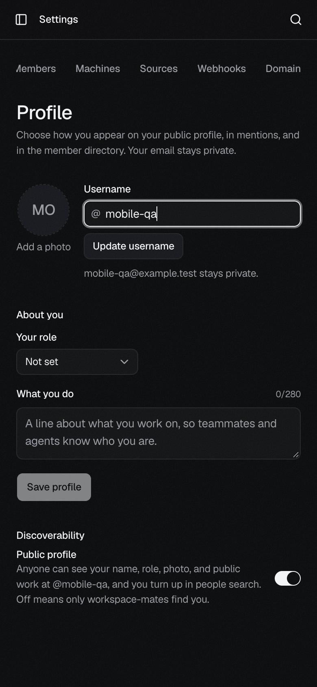
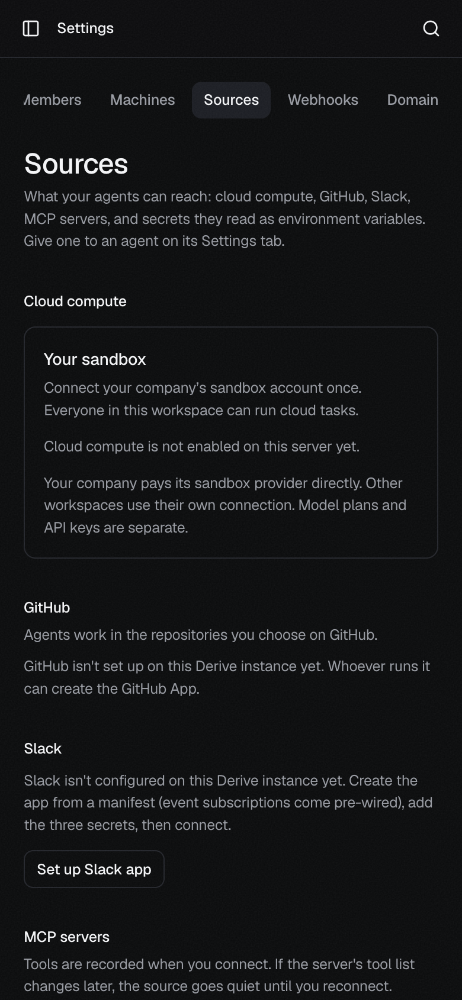
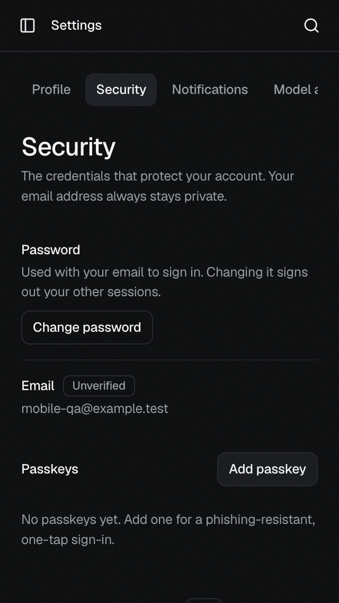
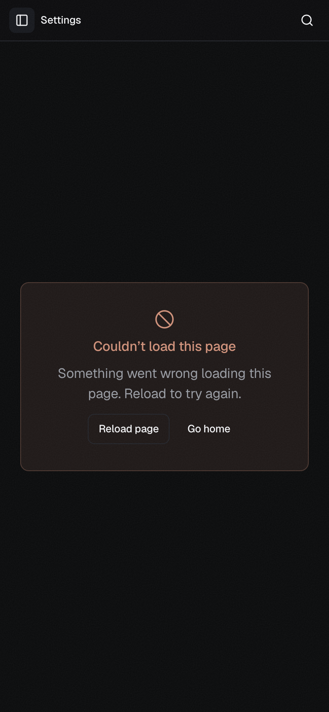
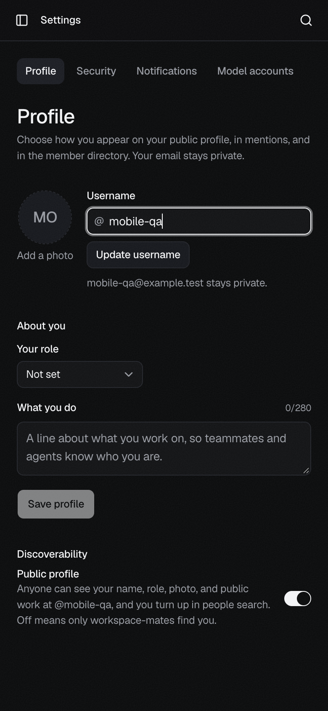
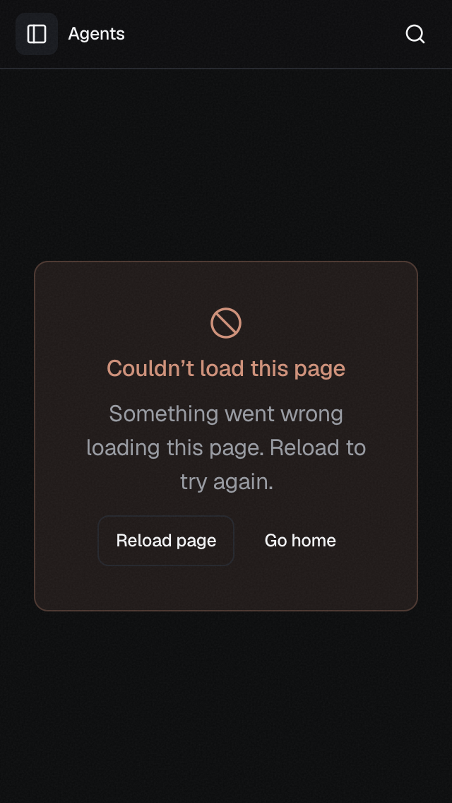
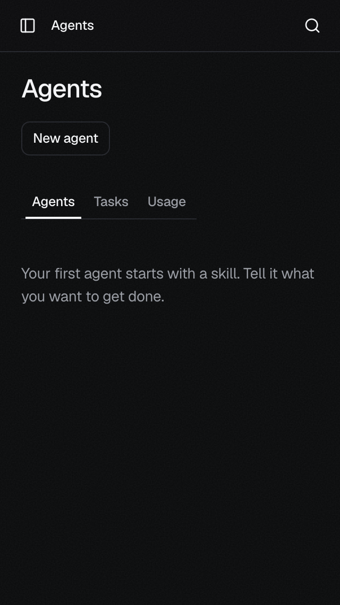

# Agents and Settings loading

Verified on October 23, 2026, with Aside.
Branch: `fix/agents-settings-mobile`. Base: `7cc4ee2f`.
The local web app and API both run from this worktree.
Web: `http://localhost:3107`. API: `http://localhost:8107`.
The API uses this worktree's `.localdata` SQLite directory.
The account is Mobile QA. The workspace is Personal.

| Loading dependency | Before | After |
| --- | --- | --- |
| Agents: recent tasks and member names | Route waits for both reads | Reads run in the background |
| Settings: other sections | Profile downloads all sections | Each section loads when selected |
| Browser view transitions | Enabled globally | Disabled, as the router comments intend |
| Page error recovery | Repeats a rejected module import | Reloads the document at the current URL |

## Delayed history

A temporary local proxy on port 8108 forwards requests to the owned API.
It holds `GET /v1/jobs?limit=200` for 60 seconds, then returns 503.
The web app uses that proxy during this check.
No production requests are changed.

1. Start a fresh app session with the original Agents loader from the base commit.
2. Open `/agents` at 390 × 844.
3. Keep the recent-tasks request pending.
4. Observe that the Agents heading and roster do not render after seven seconds.
5. Restore the changed loader and open a fresh frame with the same fault.
6. Observe the Agents heading, tabs, and empty roster while history still waits.

The roster does not depend on recent history. Tasks retains its own loading and error states.

## Settings and mobile navigation

Open Settings with the signed-in local account.
Select Profile, Sources, Security, and Members.
The navigation stays visible while a section loads.
The loading placeholder gives way to the selected section.

Profile and Sources load at 390 × 844.
Security loads at 320 × 568.
The measured body width equals the frame width at both sizes.
Agents also opens through the mobile navigation drawer.

## Build and browser evidence

The production web build passes after the final code change.
The Settings route chunk falls from 212.30 KB to 23.61 KB.
Its compressed size falls from 68.11 KB to 9.10 KB.
These values describe the route chunk, not all shared dependencies.
The split sections use TanStack's existing lazy loader, including stale-chunk recovery.

Before the router change, the browser reports:
`InvalidStateError: Transition was aborted because of invalid state. Document hidden`.
Global transitions are now disabled. Navigation no longer starts those transitions.

## Limits

Desktop Agents and Settings also load on derive.to during this session.
The local fault reproduces one loading failure, not the exact reported phone session.
Mobile checks use real iframe viewports in Aside, not a physical phone or Safari.
The screenshots use the existing dark theme.
This branch is not deployed. No CI status is inspected.

## Reported Profile error and recovery

The reported URL is `/settings/profile`.
The supplied screenshot shows the route error boundary. It does not show a 404.

A production-build check reproduces that screen with a missing Settings module.
The local account and database stay the same.
The built app runs on port 8117, with a temporary viewport proxy on port 8127.
The proxy removes framing headers only from local responses to permit iframe viewports.
No deployed response or app security configuration changes.

1. Open the built app. Temporarily move its Settings route module out of the asset directory.
2. Select Settings. Confirm the module GET returns 404 and the page error appears.
3. Restore the module. Click the original **Try again** button.
4. Confirm the error remains. The browser retains the rejected import.
5. Refresh the browser. Confirm Profile opens at the same URL.
6. Repeat with the changed **Reload page** button at 390 × 844.
7. Restore the module and select **Reload page**. Confirm Profile opens with the signed-in session.
8. Repeat for the Agents route module at 320 × 568. Confirm Agents opens at `/agents`.

The changed recovery reloads the current URL. It does not switch workspaces.
The production build passes. The phone checks use its compiled JavaScript, not the development server.

This proves the failed-download recovery defect and its repair.
The screenshot alone cannot establish the original phone's exception or failed request.
The deployed mobile session and physical Safari remain unverified.
